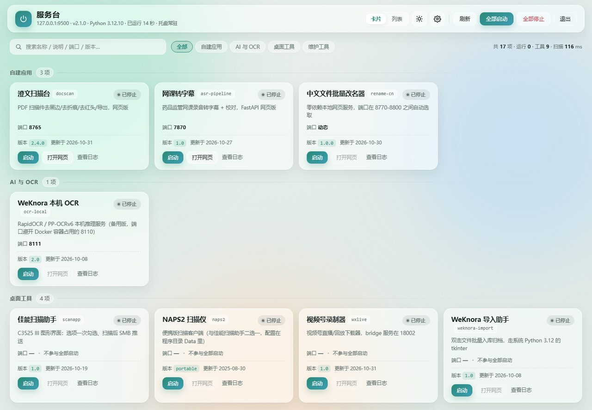
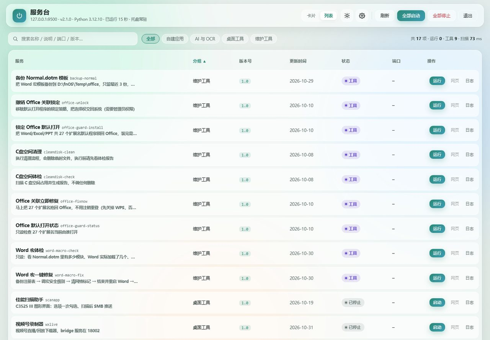
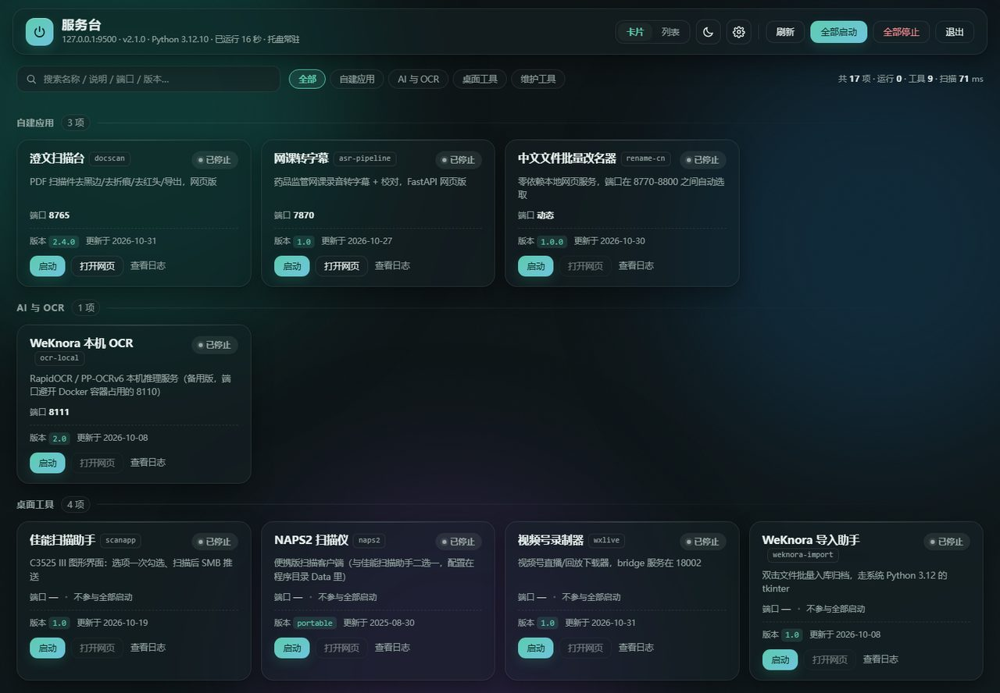

# 服务台 · ServiceHub

> 仓库：<https://github.com/gui8912/ServiceHub>（私有）
> 当前版本：**2.6.3**（2026-11-04，第三轮审计：补齐 2.6.2 端口归属链路、Host/Origin 纵深防御、布局保存回滚；2.6.2 端口冲突显式化；2.6.1 浏览器链路说明）

本机所有自建服务 / 小工具的**一个入口**：托盘常驻，浏览器里一张面板，逐个启停、看状态、开网页。
从 PowerShell + WinForms 重写而来 —— 旧版一轮 WMI 扫描要 600–700ms，界面周期性假死；
现在换成 Python + psutil + 网页界面，一轮采集约 50–60ms，接口只读缓存，实测 20ms 级返回。

- 后端：Python 3.10+（标准库 `ThreadingHTTPServer`，零 Web 框架）
- 采集：`psutil`（进程命令行 + 监听端口）
- 前端：手写 HTML/CSS/JS，零 CDN、零构建，断网也能用
- 依赖不污染系统：全部装在 `runtime\site-packages`，由启动脚本自己 `sys.path` 加载

## 界面

| 卡片视图（明亮） | 列表视图 |
|---|---|
|  |  |

暗色主题：



护眼玻璃面板，明暗两套主题（可跟随系统）；卡片和列表两种视图；列表按任意列排序。

## 首页布局（2.4.x / 2.5.0）

卡片视图固定**等宽四列**（窄屏自动退 3 / 2 / 1 列），17 条服务比起旧的三列少滚一屏。
一次性工具（`kind: "tool"`）显示为**单行扁条**，只有「运行」按钮，不占整张竖卡。

点顶栏 **布局** 进入编辑模式（同 Homarr 2.0 的做法：平时点卡片不会误拖）：

| 能做什么 | 怎么做 | 存在哪 |
|---|---|---|
| **拖动卡片换组内位置** | 编辑模式下按住卡片拖到目标位置，落点有竖线提示 | `settings.json` 的 `service_order` |
| **拖动卡片换组** | 同上，拖到别的分组区域即可 | `settings.json` 的 `service_group` |
| **拖动分组换序** | 按住分组标题往上/下拖，松手才写盘 | `settings.json` 的 `group_order` |
| **新建分组（2.5.0）** | 编辑模式下内容区底部「＋ 新建分组」，空组带"拖到这里"占位 | `settings.json` 的 `group_order` |
| **重命名分组（2.5.0）** | 编辑模式下分组标题右侧「改名」。组内卡片跟着改名走 | `group_order`/`service_order`/`service_group` 联动 |
| **删除分组（2.5.0）** | 编辑模式下「删除」。纯自定义组可删，组内卡片回原分组；注册表原始分组禁删 | 同上 |
| **隐藏卡片** | 编辑模式下点卡片右上角的「眼睛」 | `settings.json` 的 `hidden_ids` |
| **恢复隐藏** | 编辑模式下列表底部「已隐藏 N 个」→ 点名字恢复 | 同上 |
| **折叠分组** | 点分组标题左侧的箭头，状态记在浏览器本地 | `localStorage` |
| **组内批量启停** | 分组标题右侧「启动本组 / 停止本组」 | — |
| **密度切换** | 设置 → 外观 → 界面密度：舒适 / 紧凑 | `settings.json` 的 `density` |
| **一键还原** | 设置 → 首页布局 → 恢复默认顺序 | 清空上面三项 |
| **备份 / 恢复（2.6.0）** | 设置 → 首页布局 → 导出备份 / 从备份恢复；导入前显示摘要并确认 | JSON 下载文件，含设置与首页布局 |

设计取舍：**可见性和顺序都不写进 `services.json`**。注册表只描述「服务是什么」，
布局是「我怎么看它」—— 这样手工改注册表、从 GitHub 重新 clone 都不会覆盖你的布局，
删掉的服务的残留 id 渲染时直接忽略，不留垃圾。

卡片拖到别的组后，`service_group` 里记一笔 `{服务id: 分组名}` 覆盖注册表的 `group`；
把它拖回注册表原本的组时，这条覆盖会自动删除，不留下无意义的记录。

## 快速开始

### 本机（已装好）

双击 `启动服务台.bat` → 托盘出现图标，浏览器自动打开 `http://127.0.0.1:9500/`。

### 换一台电脑（笔记本等）

```bat
git clone https://github.com/gui8912/ServiceHub.git "D:\Tools\服务台"
cd /d "D:\Tools\服务台"
启动服务台.bat
```

> 仓库是私有的，第一次 clone 需要登录：用同一 GitHub 账号，密码处填 Personal Access Token
> （Settings → Developer settings → Personal access tokens → 勾 `repo`）。登录一次后
> Windows 凭据管理器会记住，后续 pull/push 不再询问。

首次运行发现 `runtime\site-packages\psutil` 不存在，会自动调用 `setup-deps.bat`
把 `psutil / pystray / Pillow` 装进工具自己的目录（需要本机有 Python 3.10+）。

单独装依赖、看详细报错：

```bat
setup-deps.bat
```

诊断（不弹浏览器，只打印报告，同时写 `logs\selftest-report.txt`）：

```bat
启动服务台.bat --selftest
```

## 目录结构

```
服务台\
├─ ServiceHub.py            入口：解析参数、起 HTTP 服务、挂托盘
├─ hub\
│  ├─ registry.py           services.json 解析 + 本机差异层
│  ├─ monitor.py            后台采集线程（进程/端口 → 状态行）
│  ├─ actions.py            启动 / 停止 / 运行工具 / 打开网页
│  ├─ server.py             HTTP 路由 + JSON 接口 + 静态文件
│  ├─ settings.py           设置读写（含类型校验、原子落盘）
│  ├─ autostart.py          开机自启（写当前用户 HKCU\...\Run，免提权）
│  ├─ browsers.py           从注册表发现已装浏览器，按选择打开
│  ├─ meta.py               版本号 / 更新时间推断
│  ├─ tray.py               托盘图标与菜单
│  ├─ logger.py             日志（logs\hub-日期.log）
│  └─ ui\                   index.html / style.css / app.js
├─ services.json            服务注册表（唯一配置源，入库）
├─ services.local.example.json  本机差异层样例（复制成 .local.json 生效，不入库）
├─ 启动服务台.bat           启动器（纯 ASCII + CRLF + 无 BOM）
├─ setup-deps.bat           依赖安装（纯 ASCII + CRLF + 无 BOM）
├─ svc.cmd / svc.ps1        命令行入口：svc list / start / stop / open
└─ 服务台说明.txt           中文使用说明（UTF-8 BOM）
```

`runtime\`（端口号、pid、设置）、`logs\`、`apps\`（指向各工具目录的联接）都不入库。

## services.json 字段

| 字段 | 说明 |
|---|---|
| `id` | 唯一标识，`svc` 命令行用的也是它 |
| `name` / `group` / `desc` | 显示名、分组、一句话说明 |
| `kind` | `proc` 常驻进程 / `tool` 一次性工具 |
| `exe` / `args` / `cwd` | 可执行文件、参数（**数组**）、工作目录 |
| `marker` | 命令行特征串，无端口进程靠它探活与停止 |
| `health` | `port` 看端口 / `cmdline` 看命令行特征 / `none` 不探活 |
| `port` / `url` | 固定端口与网页地址 |
| `web` | `true` 表示「这个端口就是网页」，运行时按端口拼出地址（本机 OCR 的 8111）。不标就不猜——数据库、消息队列的端口不是网页 |
| `urlPattern` | 动态端口：正则从子进程日志里抓端口，第 1 个捕获组必须是端口 |
| `autostart` | `false` 表示「全部启动」时跳过（桌面 GUI 工具别被批量拉起） |
| `confirm` | 有风险的动作写一句提示，网页点「运行」前先弹确认 |
| `version` / `updated` | 手写优先；不写则从 `package.json` / `version.txt` / 目录内最新文件推断 |

### 运行时状态字段（`/api/status` 返回，不是配置项）

| 字段 | 说明 |
|---|---|
| `state` | 运行中 / 外部运行 / 启动中 / 工具 / 已停止 / 未安装 |
| `running` / `ready` | 进程活着 / 端口已就绪 |
| `managed` / `external` | 是否工作台拉起 / 是否外部启动 |
| `port` / `portText` / `url` | 端口与网页入口 |
| `uptime` / `pid` | 已运行秒数 / 进程号 |
| `lastExit` | 上次托管进程的退出码（主动停止不计；异常退出时给前端提示） |
| `missing` | 可执行文件或工作目录在本机不存在 |
| `markerPids` | 按命令行特征找到的进程（外部实例停止时用） |
| `portConflict` | 固定端口被别的程序占用时的 `{port,pid,name}`；胶囊悬停可见占用者 |

## 换机差异：services.local.json

`services.json` 入库共享，每台机器的工具路径却常常不同。把
`services.local.example.json` 复制成 `services.local.json`（已 gitignore）后：

- 默认**按 id 合并**：只写要覆盖的字段，其余沿用主表；新 id 直接追加
- `"remove": ["wslive"]` 隐藏本机没有的条目
- `"mode": "replace"` 整份清单改用本文件的（笔记本上只留自己装得上的工具时最省事）

条目路径失效时，界面会显示灰色「未安装」，不会假装「已停止」。

## 安全与边界

- 只监听 `127.0.0.1`，不对外网开放
- 所有写操作（启停、改设置）要求请求头 `X-ServiceHub: 1`，且预检不返回 CORS —— 别的网页无法偷偷调
- **2.6.3 起还校验 `Host` / `Origin` 必须是 `127.0.0.1`、`localhost` 或 `::1`**：
  仅靠自定义头挡不住 DNS rebinding（外部域名重解析到本机后请求就变同源）。从自定义域名访问会被 403 拒绝
- 服务以当前用户身份运行，没有提权逻辑
- 停止服务时先按 `marker` 找进程；外部已启动的实例按监听端口反查 PID
- **2.6.0 起「全部停止」只停本工作台拉起的进程**；外部运行实例仅在单卡「停止」并二次确认后才会结束
- 设置写盘失败返回 HTTP 500，前端不再误报成功；同秒重复启动的日志自动加序号，不覆盖旧日志

## 编码约定（改文件前务必遵守）

| 类型 | 要求 | 原因 |
|---|---|---|
| `.bat` / `.cmd` | 纯 ASCII、CRLF、**无 BOM** | cmd 按代码页解析：带 BOM 首行会变成 `锘緻echo off`；裸 LF 会把多行连成一行；中文会乱码 |
| `.ps1` / `.txt` | UTF-8 带 BOM、CRLF | PowerShell 5.1 与记事本才认 |
| `.py` / `.js` / `.css` / `.json` | UTF-8、LF | 跨平台、便于 diff |

`.gitattributes` 已固定这些换行规则，克隆下来不会跑偏。

## 常见问题

- **想重启某个服务**：运行中的常驻服务卡片上多了「重启」（等价于先停再起）；也可 `POST /api/action {"id":"xxx","action":"restart"}`。
- **卡片显示"上次退出 1"**：说明上次不是从工作台正常停止的（崩溃/被杀）。切到列表视图点「日志」看最后输出（2.5.0 起卡片操作区不再放日志按钮）；主动停止不会显示这个标记。
- **托盘图标不见了**：双击 `启动服务台.bat` 重新唤起；已启动的业务服务不受影响。
- **关掉浏览器标签页**：服务台仍在运行，退出请点面板右上角「退出服务台」或托盘右键。
- **端口被占**：默认 9500，被占用则自动 +1（9500–9519），实际端口见 `runtime\port.txt`。
- **改了浏览器 / 主题**：立即生效，不必重启。
- **「打开网页」按钮不见了**：只在该服务**真的有地址**时出现。服务没运行（动态端口型，如「中文文件批量改名器」）或本来就没有网页（各工具卡）时不再画灰按钮——2.6.1 之前是画出来再置灰，点了没反应，看着像按钮坏了。视频号录制器 5.7.1 起自带网页界面（8766），所以又重新有按钮了。
- **状态显示「端口冲突」**：这个卡片要用的端口正被**别的程序**占着，悬停胶囊能看到占用者的进程名和 PID。
  此状态下「启动」会当场报错而不是假装启动，「打开网页」也会如实拒绝（2.6.3 之前这两条路径会绕过 2.6.2 的保护）。
  服务**没运行**时只显示「已停止」，冲突详情仍挂在胶囊悬停提示里，不再常驻红色告警。
- **布局改完刷新却回退了**：2.6.3 起保存失败会弹错误并立刻从服务端拉回真实布局，界面不再与 `settings.json` 分叉。
- **GitHub 拉取慢**：给 git 配代理 `git config --global http.proxy http://127.0.0.1:端口`。

### 设了 ego，打开却是 Edge

2.6.1 起这条链路是**明说**的，不再靠猜：

1. **设置 → 打开网页用哪个浏览器**，下拉框下面直接写着「实际使用：ego lite　完整路径」；
   如果那一刻探测不到该浏览器（ego 自更新时 `Application\ego.exe` 会短暂消失），这里会变成红字
   「⚠ 没找到…——点打开网页会退回系统默认浏览器（本机是 Edge）」。
2. 点「打开网页」后的提示也带浏览器名：`已用 ego lite 打开 http://…`；
   一旦发生退回，提示会写成 `⚠ 用 ego lite 打开失败（…），已改用系统默认浏览器打开 …`。
3. 日志里每次开面板都留一行：`打开面板：http://127.0.0.1:9500/ → 已用 ego lite 打开 …`。

要现场验证：设置页底部 **用这个浏览器打开服务台**。若它开的是 Edge，设置页那行红字会同时告诉你原因
（找不到 exe / 自定义路径失效 / 调用失败）。

### 页面"一直闪" / 像在自动刷新

页面唯一会动的东西是背景那 3 个缓慢漂移的光斑，卡片本身不会重建。如果闪得像在刷新，按顺序试：

| 地址 | 效果 |
|---|---|
| `http://127.0.0.1:9500/?fx=noanim` | 只停背景光斑动画 |
| `http://127.0.0.1:9500/?fx=noblur` | 只关毛玻璃（`backdrop-filter`） |
| `http://127.0.0.1:9500/?fx=off` | 两样都停，页面彻底静止 |

哪个不闪了，原因就是哪个；左下角会出现橙色角标提示当前处于诊断模式，去掉 `?fx=` 即恢复正常。
若 `?fx=off` 仍然闪，说明与页面样式无关，问题在浏览器/显卡：

1. 先在浏览器里打开任意其他网页对比——如果别的页面也闪，是**浏览器硬件加速**问题，
   到设置里关掉「使用硬件加速」再看；
2. 卸载/更新显卡驱动；
3. 换 Chrome 打开同一地址对比。

**2.3.1 已修的部分**：卡片原本各带一层 `backdrop-filter: blur(22px)`，压在永不停歇的背景光斑上，
每帧都要为 17 张卡片重算大区域模糊，集显/老内核上会持续抖动。现已去掉卡片的背板模糊
（背景本身已是柔和色团，再糊一次肉眼几乎无差），毛玻璃元素从 21 个降到 4 个；
光斑也从 `filter: blur(90px)` 改成径向渐变，并且**默认不再播放漂移动画**。
需要"呼吸感"可在 设置 → 外观 → 背景动效 里打开。

### 开机自动启动

设置 → 行为 → **开机自动启动**，打开即可。实现方式：

```
HKEY_CURRENT_USER\Software\Microsoft\Windows\CurrentVersion\Run
  ServiceHub = "…\pythonw.exe" "D:\Tools\服务台\ServiceHub.py" --no-open
```

- 只写**当前用户**的启动项，不需要管理员权限，也不注册系统服务；
- 用 `pythonw.exe`，开机不会闪黑框；带 `--no-open`，开机只让托盘出现，不抢着弹浏览器；
- 关掉只是删这一个注册表值，不残留；
- 也可以从「任务管理器 → 启动应用」里关，服务台下次打开设置时会如实显示已关闭。

> 如果整个 `D:\Tools\服务台` 目录被挪走，自启会指向旧路径。设置页会显示「登记的是旧路径」，
> 关一次再开一次即可刷新。不想用它时，直接删 `HKCU\...\Run` 下的 `ServiceHub` 值。

## 源码审计与验证记录

三轮审计的 8 项交付报告与按原路径分节的完整合并源码都留在仓库里，方便回查「这行为什么改」：

| 轮次 | 报告 | 合并源码 |
|---|---|---|
| R1（2.3.0） | `AUDIT-2026-11-01.md` | `docs/ALL-SOURCE-2.3.0.md` |
| R2（2.6.0） | `AUDIT-2026-11-01-R2.md` | `docs/ALL-SOURCE-2.6.0.md` |
| R3（2.6.3） | `AUDIT-2026-11-04-R3.md` | `docs/ALL-SOURCE-2.6.3.md` |

合并源码由 `python runtime\gen_all_source.py 2.6.3` 逐字节抄录生成，改动行保留源文件里的
`# modified` / `// modified` 标注。回归命令与实测结果见 R3 报告第 8 节；前端脚本可用
`PROBE_URL=http://127.0.0.1:9511` 指向独立测试实例，避免干扰 9500 上的常驻面板。
修改前的完整备份在 `runtime\audit-backup-20261104\`。
